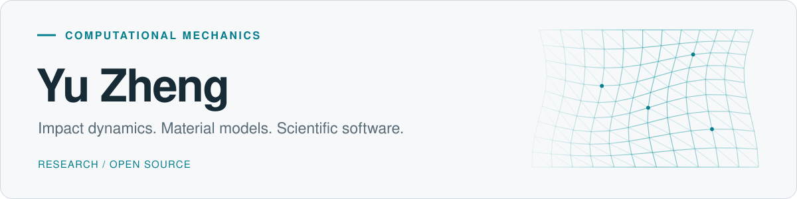

<picture>
  <source media="(prefers-color-scheme: dark)" srcset="assets/header-dark.svg" />
  <source media="(prefers-color-scheme: light)" srcset="assets/header-light.svg" />
  
</picture>

 

I work on **computational mechanics**, with a focus on **impact dynamics, constitutive modeling, and material failure**. I'm also exploring **differentiable simulation** for material characterization and inverse problems.

I contribute to open-source scientific software for computational mechanics.

[Email](mailto:yuzheng@mail.ustc.edu.cn) &nbsp;·&nbsp; [Contributions](https://github.com/pulls?q=is%3Apr+author%3Alililii124+-user%3Alililii124) &nbsp;·&nbsp; [Repositories](https://github.com/lililii124?tab=repositories)

## Selected open-source work

<table>
  <tr>
    <td colspan="2" valign="top">
      MATERIAL POINT METHOD
      <h3><a href="https://github.com/lililii124/jax-mpm">jax-mpm</a></h3>
      
A 2D/3D JAX material point solver with constitutive models, two-body contact, fluid–solid examples, and ParaView output.

      <a href="https://github.com/lililii124/jax-mpm">View repository ↗</a>
    </td>
  </tr>
  <tr>
    <td width="50%" valign="top">
      IMPACT &amp; MATERIAL FAILURE
      <h3><a href="https://github.com/OpenCourant/OpenCourant">OpenRadioss / OpenCourant</a></h3>
      
Three-surface RHT solid material model and verification tools.

      <a href="https://github.com/OpenCourant/OpenCourant/commit/1a0d691b82bd4f94a3bc2399682551e84e1d5fa4">View contribution ↗</a>
    </td>
    <td width="50%" valign="top">
      PARTICLE METHODS
      <h3><a href="https://github.com/Xiangyu-Hu/SPHinXsys">SPHinXsys</a></h3>
      
SYCL support for the HJC material model and a Taylor-bar impact example.

      <a href="https://github.com/Xiangyu-Hu/SPHinXsys/pull/1123">View pull request ↗</a>
    </td>
  </tr>
  <tr>
    <td width="50%" valign="top">
      DIFFERENTIABLE SIMULATION
      <h3><a href="https://github.com/deepmodeling/jax-fem">JAX-FEM</a></h3>
      
Newton iteration limits and explicit nonconvergence reporting.

      <a href="https://github.com/deepmodeling/jax-fem/pull/96">View pull request ↗</a>
    </td>
    <td width="50%" valign="top">
      SCIENTIFIC SOFTWARE
      <h3><a href="https://github.com/OpenDiS/OpenDiS">OpenDiS</a></h3>
      
ParaDiS extension installation validation and relative-path fixes.

      <a href="https://github.com/OpenDiS/OpenDiS/pull/44">View pull request ↗</a>
    </td>
  </tr>
</table>

<strong>All upstream contributions</strong> · automatically updated

<!-- OPEN-SOURCE-WORK:START -->
**4 merged PRs · 7 open PRs · 9 repositories**

| Project | Upstream work | Open PRs | Latest contribution |
| --- | ---: | ---: | --- |
| [OpenRadioss (OpenCourant)](https://github.com/OpenCourant/OpenCourant) | [Commit history](https://github.com/OpenCourant/OpenCourant/commits/main/?author=lililii124) | — | [Add three-surface RHT solid USER01 material and verification tools · commit](https://github.com/OpenCourant/OpenCourant/commit/1a0d691b82bd4f94a3bc2399682551e84e1d5fa4) |
| [SPHinXsys](https://github.com/Xiangyu-Hu/SPHinXsys) | [2 PRs](https://github.com/Xiangyu-Hu/SPHinXsys/pulls?q=is%3Apr%20author%3Alililii124%20is%3Amerged) | [1](https://github.com/Xiangyu-Hu/SPHinXsys/pulls?q=is%3Apr%20author%3Alililii124%20is%3Aopen) | [#1127 · Add Johnson–Cook material and CPU/SYCL necking examples](https://github.com/Xiangyu-Hu/SPHinXsys/pull/1127) |
| [JAX-FEM](https://github.com/deepmodeling/jax-fem) | [1 PR](https://github.com/deepmodeling/jax-fem/pulls?q=is%3Apr%20author%3Alililii124%20is%3Amerged) | — | [#96 · Limit Newton iterations and report nonconvergence](https://github.com/deepmodeling/jax-fem/pull/96) |
| [OpenDiS](https://github.com/OpenDiS/OpenDiS) | [1 PR](https://github.com/OpenDiS/OpenDiS/pulls?q=is%3Apr%20author%3Alililii124%20is%3Amerged) | — | [#44 · Fix ParaDiS extension installation validation and relative paths](https://github.com/OpenDiS/OpenDiS/pull/44) |
| [SOFA](https://github.com/sofa-framework/sofa) | — | [1](https://github.com/sofa-framework/sofa/pulls?q=is%3Apr%20author%3Alililii124%20is%3Aopen) | [#6377 · \[HyperElastic\] Fix inverted Stable Neo-Hookean scene and add regres…](https://github.com/sofa-framework/sofa/pull/6377) |
| [Regression](https://github.com/sofa-framework/Regression) | — | [1](https://github.com/sofa-framework/Regression/pulls?q=is%3Apr%20author%3Alililii124%20is%3Aopen) | [#142 · Add reference states for the Stable Neo-Hookean inverted-tetrahedra…](https://github.com/sofa-framework/Regression/pull/142) |
| [Peridigm](https://github.com/peridigm/peridigm) | — | [1](https://github.com/peridigm/peridigm/pulls?q=is%3Apr%20author%3Alililii124%20is%3Aopen) | [#407 · Add HJC correspondence material](https://github.com/peridigm/peridigm/pull/407) |
| [PySPH](https://github.com/pypr/pysph) | — | [2](https://github.com/pypr/pysph/pulls?q=is%3Apr%20author%3Alililii124%20is%3Aopen) | [#439 · Fix CRKSPH OpenCL kernel compilation](https://github.com/pypr/pysph/pull/439) |
| [SoliDualSPHysics](https://github.com/naqibr/SoliDualSPHysics) | — | [1](https://github.com/naqibr/SoliDualSPHysics/pulls?q=is%3Apr%20author%3Alililii124%20is%3Aopen) | [#2 · Add HJC concrete material](https://github.com/naqibr/SoliDualSPHysics/pull/2) |

Public upstream PRs and preserved commits · updated 2026-10-24 · refreshed twice daily
<!-- OPEN-SOURCE-WORK:END -->

<strong>GitHub activity</strong>

 

<picture>
  <source media="(prefers-color-scheme: dark)" srcset="https://github-profile-summary-cards.vercel.app/api/cards/profile-details?username=lililii124&amp;theme=github_dark" />
  <source media="(prefers-color-scheme: light)" srcset="https://github-profile-summary-cards.vercel.app/api/cards/profile-details?username=lililii124&amp;theme=github" />
  
</picture>

---

I'm interested in discussing constitutive models, impact simulation, and open-source scientific software. Feel free to reach out at [yuzheng@mail.ustc.edu.cn](mailto:yuzheng@mail.ustc.edu.cn).
